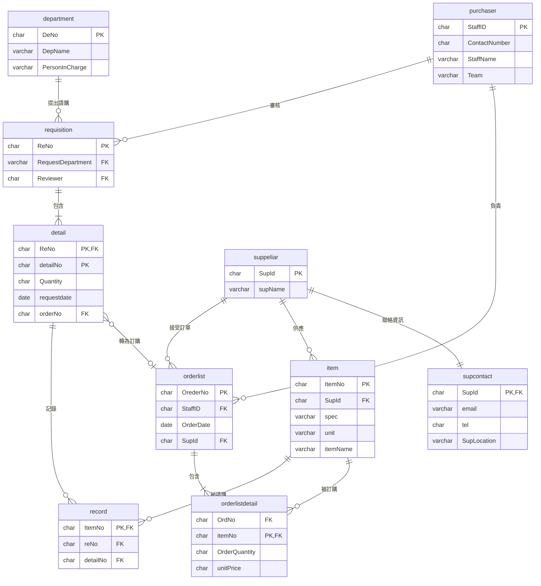
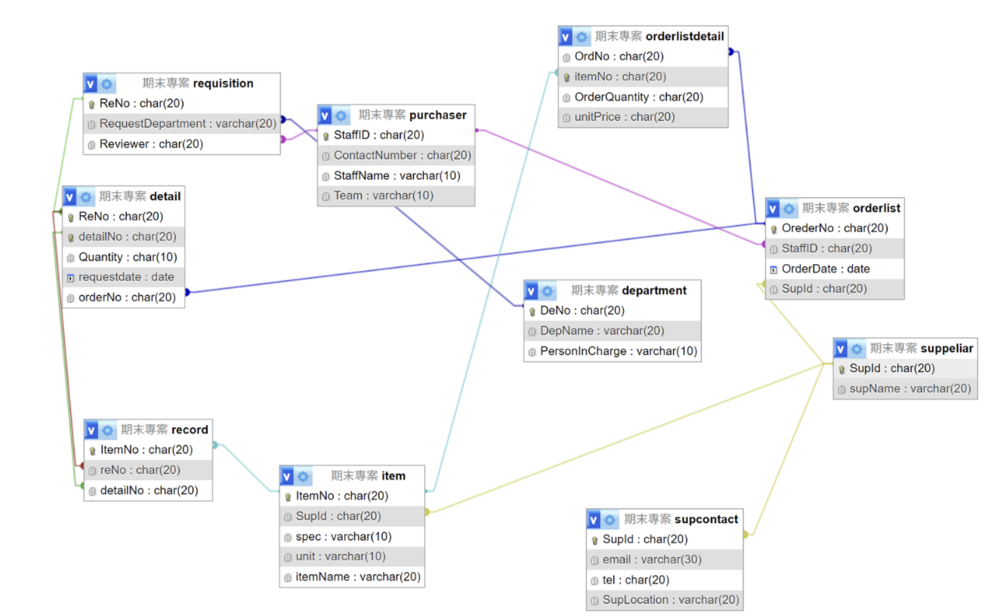

# 醫院醫材採購訂購系統 (Hospital Medical Supply Purchasing System)

以 MySQL 設計的醫院醫材請購與訂購資料庫，模擬「科室提出請購 → 採購人員審核 → 向供應商下訂單」的完整流程。（資料庫課程期末專案）

## 使用技術
- MySQL（透過 XAMPP / phpMyAdmin 建置）

## 資料庫設計

| 類型 | 資料表 | 說明 | 主鍵 |
|------|--------|------|------|
| 實體 | `item` 醫材物品 | 醫材名稱、規格、單位、供應商 | ItemNo |
| 實體 | `department` 醫院科室 | 科室名稱、負責人 | DeNo |
| 實體 | `requisition` 請購單 | 請購科室、審核人員 | ReNo |
| 實體 | `purchaser` 採購人員 | 姓名、電話、組別 | StaffID |
| 實體 | `orderlist` 訂購單 | 負責採購人員、供應商、訂購日期 | OrederNo |
| 實體 | `suppeliar` 供應商 | 供應商名稱 | SupId |
| 弱實體 | `detail` 請購單明細 | 依附請購單，記錄數量、請購日期、對應訂購單 | (ReNo, detailNo) |
| 弱實體 | `orderlistdetail` 訂購單明細 | 依附訂購單，記錄醫材、數量、單價 | itemNo |
| 輔助表 | `record` | 連結請購明細與醫材品項 | ItemNo |
| 輔助表 | `supcontact` | 供應商聯絡資訊（email、電話、地址） | SupId |

### ER 關係圖

phpMyAdmin 設計器畫面：

## 業務流程
1. 醫院**科室**建立**請購單**，在**請購明細**中填寫數量與請購日期，並透過 `record` 對應到醫材品項
2. **採購人員**審核請購單（`Reviewer`）
3. 採購人員向**供應商**開立**訂購單**，請購明細記錄對應的訂購單號（`orderNo`）
4. **訂購單明細**記錄每項醫材的訂購數量與單價

## 如何執行
1. 安裝 [XAMPP](https://www.apachefriends.org/)，啟動 Apache 與 MySQL
2. 開啟 `http://localhost/phpmyadmin`
3. 新增一個資料庫（例如 `期末專案`，編碼選 `utf8mb4_general_ci`）
4. 點「匯入 (Import)」，選擇 `database/medical_purchase.sql`

## 範例資料
內含 10 個科室、10 位採購人員、10 家供應商、30 項醫材，以及 17 張請購單、10 張訂購單的測試資料（皆為虛構）。

## 設計重點
- 以弱實體（請購明細）搭配複合主鍵 (ReNo, detailNo) 處理一張單據多筆品項
- 以外鍵約束串起「科室 → 請購 → 訂購 → 供應商」的完整採購流程
- 將供應商聯絡資訊獨立成 `supcontact`，與供應商基本資料分開
